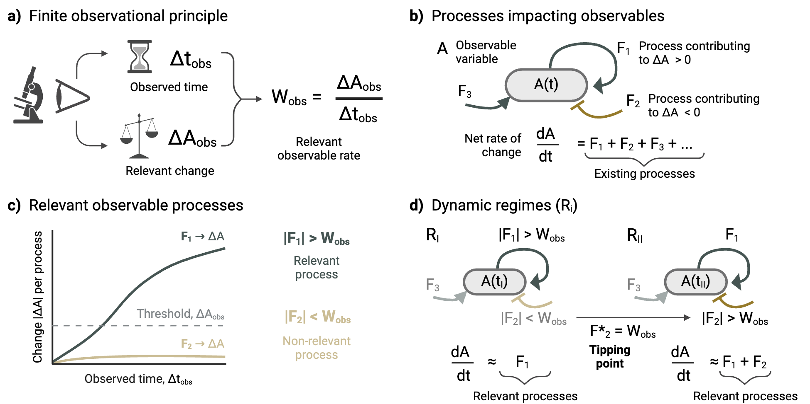

# Transient Dynamics Through Observational Principle Normalization

**Code archive:** release [`v0.2.1-alpha`](https://github.com/luquelab/transient-dynamics/releases/tag/v0.2.1-alpha), the version used for the revised manuscript, is archived on Zenodo (DOI above). To cite the code, use that DOI or GitHub's "Cite this repository" button (based on `CITATION.cff`).

## WHAT
transient-dynamics.ipynb is a Jupyter notebook that generates a simulation of a Lotka-Volterra predator-prey system, investigating finite observational principles by calculating the weight per process and classifying it as relevant or irrelevant based upon the inherent observational window set by the user. The inputs for the notebook involve the characteristics of the phage and bacteria population, the observer's observational time, and the ability to perceive change (observer's tolerance). The outputs of the notebook include population, weight, and relative error figures, alongside an Excel file output for all array-like variables produced during analysis and a text file for the float variables produced in calculations.

The quickest way to use transient-dynamics.ipynb is by running it in a Google Colab notebook in the cloud, requiring only a Google account. It can simulate scenarios and can also be run within Conda environments or on Visual Studio Code to simulate the scenarios.

The methodology and application of transient-dynamics.ipynb are available in a published pre-print on the bioRxiv pre-print server:

Sergio Cobo-López, Lucas J. Carbajal, Matthew Witt, Forest L. Rohwer, Antoni Luque. "Emergence of tipping points and transient dynamics in finite observations." bioRxiv 2023.12.27.573307 (version 3, 2025); doi: https://doi.org/10.1101/2023.12.27.573307

Below, we provide a basic description of the notebook and repository. We recommend visiting transient-dynamics.ipynb's online documentation for a more detailed guide to using the notebook.

**License**: transient-dynamics.ipynb is under an MIT license. If you use transient-dynamics.ipynb on any scientific or scholarly work, please cite the above reference to support this academic and open-source initiative from the Luque lab.

## CONTRIBUTORS
This tool was produced by @luquelab, inspired by the original manuscript's repository (needle-finder) by Sergio Cobo-López. The main contributors are Lucas J. Carbajal and Antoni Luque, with additional assistance and guidance provided by the rest of the members in the Luque Lab.

**AI assistance:** parts of the code and analyses (`results/alpha-robustness-v2`) were developed with the assistance of Claude (Anthropic) via Claude Code; all outputs were reviewed and validated by the authors.

## WHEN
This is an evolving repository Started: 2024-09-11

End: Ongoing

## FILES & FOLDERS
FOLDER: /notebooks
--> This folder contains the Jupyter notebook to run simulations of the Lotka-Volterra phage-bacteria model, with and without carrying capacity.

FOLDER: /data
--> This folder contains the example scenarios used in the manuscript (inputs and reference outputs) and the folder where the notebook writes its outputs.

FOLDER: /docs
--> This folder contains the tutorial for the notebook and the changelog. The manuscript is available as a preprint on bioRxiv (https://doi.org/10.1101/2023.12.27.573307).

FOLDER: /results
--> This folder contains the manuscript figures and the robustness analysis of the adaptive Boolean model.

FOLDER: /src
--> Reserved for the Python package that the notebook and analyses will share in a future version.

LEGACY MATERIAL
--> Code, data, results and documents from the earlier version of the project (needle-finder) are preserved in the `legacy` branch and the `v0.1.0-alpha` pre-release.

The syntax of markdown files (.md) is CommonMark unless specified otherwise (https://commonmark.org/help/)
